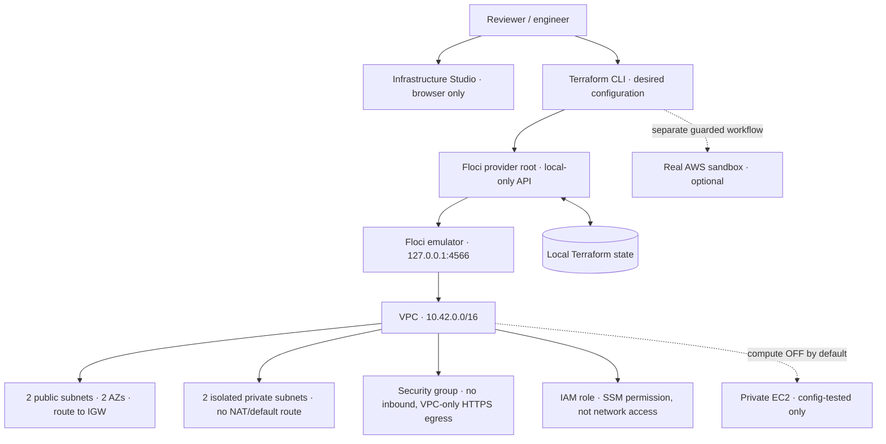

# Terraform AWS Lab
**Learn Infrastructure as Code by inspecting, building and debugging a safe local AWS-style network.**

Terraform describes *what should exist*; Floci emulates AWS APIs locally; the browser Studio teaches *why each part exists*. You can understand the architecture **without an AWS account or Docker**. The optional hands-on lab creates actual **emulated API resources**, not production AWS infrastructure.

## Start in 60 seconds

**Requirements:** Git, Python 3 and a browser. No account, credentials or admin access.

```bash
git clone https://github.com/Mishkaaass/terraform-aws-lab.git
cd terraform-aws-lab
make studio
```

Open **http://127.0.0.1:8765/**. Keep the terminal running; stop with `Ctrl+C`. Re-running `make studio` recognizes an existing healthy Studio and displays the URL instead of failing. If an unrelated app occupies the port, the command explains how to choose another port.

**First visit — follow the tabs in order:**

| Tab | Do this | You will understand |
| --- | --- | --- |
| **1 · System Map** | Click VPC → private subnet → security group → IAM | What connects to what, and why |
| **2 · Design Sandbox** | Select *Example 1: Why can't my EC2 use SSM?*; then Example 2 | How network routes differ from IAM permissions |
| **3 · Run the Real Lab** | Read **Step Zero**; then run Checkpoint 1 in a second terminal | How to test and observe Terraform safely |
| **4 · Incident Cases** | Diagnose a failure using recorded logs and source | How to reason from evidence |

**Optional last checkpoint:** If `probe.py` reports `floci: up`, `vm: stopped` and `health: unknown`, that's a valid read-only observation; the Ubuntu KVM guest is optional. Paste that JSON into **Local Machine Snapshot** and click **SHOW LOCAL STATUS** to validate the format and complete Checkpoint 7. This does not claim the VM is healthy.

The **Design Sandbox changes only a browser simulation**. Its example values are **not shell commands**. The Studio does not run Terraform, Docker or AWS commands for you.

## The architecture — what are we building?



| Component | Why it exists |
| --- | --- |
| **VPC / Subnets** | Divide the network; 2 public and 2 private subnets across two availability zones |
| **Routes / Internet Gateway** | Public subnets have an IGW route; private subnets have **no default internet route** |
| **Security Group** | Restricts instance traffic: **no inbound**, only TCP 443 to the VPC CIDR |
| **IAM / SSM** | Gives the *permission* for remote management; SSM still needs reachable endpoints |
| **Terraform state + plan** | State remembers managed resources; Plan compares the desired design with what exists |
| **Floci vs KVM** | Floci emulates the AWS *API*; the separate optional libvirt Ubuntu VM is a real local guest |

The default local deployment **does not run an EC2 instance** and does not mount the Docker socket into Floci. Browser outcomes, mock tests and Floci behavior **do not prove real AWS networking or IAM enforcement**.

## Hands-on local lab (optional, no AWS account)

In a **second terminal** in this repository:

```bash
make doctor          # READ ONLY: see what is installed, working and missing
make test            # tests Terraform rules; no Docker or AWS required
make local-up        # start/reuse Floci at 127.0.0.1:4566 (Docker needed if stopped)
make local-plan      # inspect the proposed resource changes
make local-apply     # CHANGES local Floci/state; review plan and approve manually
make local-verify    # independently query created VPC, subnets and security group
make local-drift     # CHANGES a local VPC tag; detects, guards, repairs with consent
```

**Use one command at a time.** At each checkpoint in the browser: read *why*, copy the command, run it yourself, inspect the output, and optionally paste **non-sensitive** output to check its expected marker. A marker check is **not proof** that the command ran correctly.

`make` commands automatically prefer the project's **Terraform 1.17.2** at `~/.local/opt/terraform/1.17.2/terraform`, otherwise an installed compatible **1.17.x**. They do not alter your global `PATH` or download software. If the correct version is missing, `make doctor` explains what to fix.

**Already built it?** A plan showing **`No changes` is success**. You do not need to rerun `apply` or `drift` just to complete the UI. Floci can be reused even when your user cannot access Docker, as long as its localhost API is healthy.

### Common beginner issues

| Message | What it means / safe next action |
| --- | --- |
| `Unsupported Terraform Core version` | Run `make test`, not a globally installed old `terraform`; check `make doctor` |
| `permission denied ... docker.sock` | Docker access is missing. If Floci is already healthy, `make local-up` reuses it; otherwise use an approved isolated Docker setup. **Never chmod the socket to 666.** |
| `InvalidVpcID.NotFound` | Terraform state may remember a VPC that the emulator lost. **Stop**, inspect `make doctor` and a read-only plan; do not delete state or force apply. |
| `KVM VM: shut off` | Normal for this lab. The separate Ubuntu VM is optional and independent from Floci. |

## Project layout and safety

```text
engineering-lab/       Browser Studio, safe static server, diagnostics
modules/               Reusable network / security / identity / compute
environments/floci/    Local emulated AWS, isolated Terraform state
environments/aws/      Separate guarded real-AWS sandbox (never automatic)
environments/libvirt/  Optional independent Ubuntu/KVM VM
scripts/               Local checks, guarded drift exercise, AWS safety checks
.github/workflows/     CI validation, mock tests, Floci integration, Trivy, Gitleaks
docs/                  Detailed architecture, VM guide and AWS safety runbook
```

Real AWS deployment is **not part of this quick start**. It requires a separate sandbox account, account-ID verification, cost controls and deliberate approval; read [AWS_RUNBOOK.md](docs/AWS_RUNBOOK.md) first. No CI job deploys to real AWS.

For deeper explanations, see the [Studio guide](engineering-lab/README.md), [architecture decisions](docs/ARCHITECTURE.md), [optional Ubuntu VM](docs/LOCAL_VM.md) and [security model](docs/SECURITY.md).

**Review criterion:** Can a new engineer explain why the private subnet has no internet path, distinguish IAM from connectivity, run the mock tests, verify emulated resources, and diagnose drift **without ever touching production AWS**?
