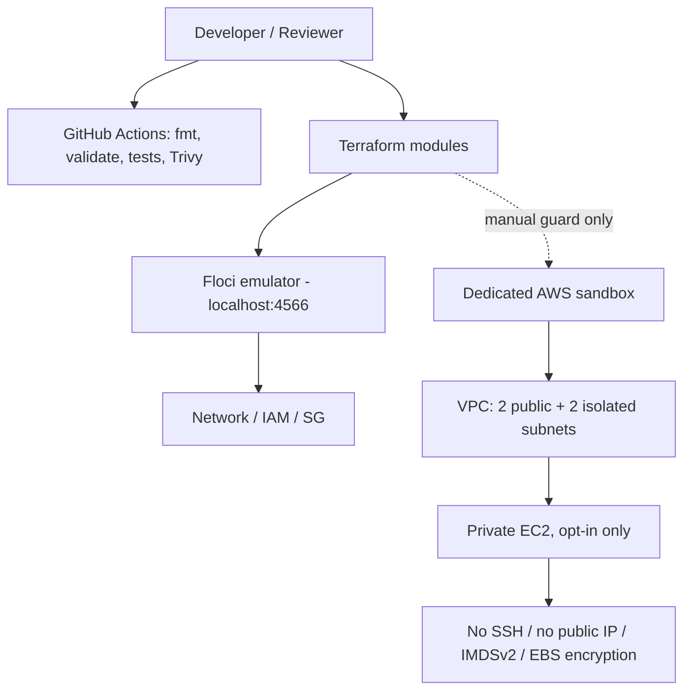

# Terraform AWS Lab — Secure Infrastructure as Code Portfolio

> A hands-on AWS infrastructure lab with reusable Terraform modules, local AWS API emulation, isolated real-AWS configuration, automated tests and security checks. Built to be understandable, reproducible, and safe to evaluate.

## What an interviewer can verify

- **Network:** one VPC, two AZs, two public subnets, two isolated private subnets, IGW + public routing, and deliberately no NAT gateway.
- **Identity:** EC2 role/profile with the AWS-managed `AmazonSSMManagedInstanceCore` policy; no administrator policy.
- **Compute (opt-in only):** private EC2 without a public IP or SSH key; IMDSv2 required; encrypted gp3 root disk.
- **Access:** zero inbound security-group rules and HTTPS-only egress restricted to the VPC CIDR.
- **Testing:** Terraform mock-provider tests cover architecture and security **without AWS credentials or Docker**.
- **Delivery:** GitHub Actions runs format, validation, mock tests, and Trivy IaC scanning with read-only permissions. No CI deploy credentials.
- **Two environments:** `environments/floci` and `environments/aws` reuse the same `modules/*` code but never share endpoints or state.

## Architecture



## Interactive Engineering Dojo — 21 decisions, 7 incidents

**[Launch the reviewer-facing failure lab](engineering-lab/README.md)**. A free local browser simulator with recorded incident evidence, fault diagnosis, competing remediation choices, engineering explanations, source-code proofs, a score and self-written incident reviews. Includes the actual KVM PCI/VirtIO and AppArmor debugging incidents, a safe Floci drift drill, IAM/network reasoning and CI evidence triage.

Run from the repository root with no AWS account, Docker, Terraform, KVM or admin access:

```bash
python3 -m http.server 8765 --bind 127.0.0.1
```

Open **http://127.0.0.1:8765/engineering-lab/**. The browser runs no shell commands, uses no credentials, and does **not** claim simulated signals are live. For optional real inspection or drift exercises, see [the learning guide](engineering-lab/README.md).

## Quick start: no AWS account needed

Requirements: Terraform **1.17.2** (HashiCorp), Docker + Docker Compose v2, and optionally AWS CLI v2 for API inspection.

```bash
make check           # see which tools are installed
make fmt             # normalize HCL formatting before first commit
make fmt-check       # no file changes
make test            # mocked AWS provider; no AWS or Docker required
make local-up        # Floci on 127.0.0.1:4566, no Docker socket
make local-plan      # inspect network / IAM changes
make local-apply     # interactive local apply; safe fake credentials
make local-verify    # AWS CLI queries to localhost (requires AWS CLI)
```

**Clean up only when desired:** `make local-destroy` (prompts), followed by `make local-down`.

## Live drift-detection demonstration

After a successful local apply and verification, run:

```bash
make local-drift
```

The drill deliberately updates only the managed VPC `Name` tag through the **localhost Floci AWS CLI** (outside Terraform), verifies Terraform exit code **2** for detected differences, inspects the saved plan to ensure **only the expected Name-tag update** is present, asks for explicit approval to repair, and checks exit code **0** after restoration. It never contacts real AWS or deletes infrastructure. Local proof logs are written under the ignored `reports/` directory.

If interrupted before repair, review `terraform -chdir=environments/floci plan` and use an interactive apply to restore the intended tag. A stopped or unsupported emulator can prevent successful completion; do not claim the drill passed unless the final `[PASS]` is printed.

The default Floci run provisions **VPC, subnets, routes, IAM and SG only**. Compute is explicitly disabled; there is **no Docker socket mount** and **no real AWS access**. To view the proposed EC2 configuration, run `make local-ec2-plan` (read-only). Terraform mock tests also validate the EC2 controls.

## Optional real AWS sandbox

**Do not deploy before reading [the AWS safety runbook](docs/AWS_RUNBOOK.md).** A sandbox AWS account, AWS CLI, least-privilege credentials, spending controls, and explicit account-ID match are required. These resource definitions are educational, not a production-ready landing zone.

```bash
export AWS_PROFILE=my-dedicated-sandbox
export AWS_EXPECTED_ACCOUNT_ID=123456789012  # replace with your sandbox account
make aws-plan                            # read-only, guarded
# Changes only with deliberate opt-in and Terraform's interactive approval:
I_UNDERSTAND_AWS_CHARGES=YES make aws-apply
```

`enable_compute` defaults to `false`. A private EC2 without NAT or VPC endpoints is *isolated and cannot be managed with SSM yet*. Do not switch it on in real AWS until adding **SSM interface endpoints** or another explicitly secure connectivity path. This is the next extension exercise.

## Repository layout

```text
modules/network      VPC, public/private subnets, routes
modules/security     SG with no inbound and HTTPS-only egress
modules/identity     IAM role, SSM policy, instance profile
modules/compute      Optional secure-by-default EC2

environments/floci   Fake credentials + local endpoints; Terraform tests
environments/aws     Real AWS provider + allowed_account_ids guard
scripts              Tool checks, emulator verification, guarded AWS commands
.github/workflows    CI quality and IaC security

docs                 Architecture, security model, guided labs, AWS runbook
```

## Security & honesty about limitations

Floci emulates AWS APIs, not AWS's actual isolation, IAM enforcement, network dataplane, pricing, or reliability. EC2 execution in Floci requires access to Docker's socket; that high-privilege mount is *intentionally not enabled*. The mock tests verify Terraform **configuration intent**, not cloud behavior. The IaC security scan may identify findings that must be triaged before publication; CI success must be verified on GitHub.

State: the repo ignores all local Terraform state and variable files. After the **first `terraform init` in each environment**, commit the generated `.terraform.lock.hcl` files to make provider resolution reproducible. Never commit credentials or state.

## Learning modules

See [guided lab](docs/LEARNING_PATH.md), [architecture decisions](docs/ARCHITECTURE.md), [security](docs/SECURITY.md), and [AWS runbook](docs/AWS_RUNBOOK.md).

## Official references

- [Terraform test / provider mocking](https://developer.hashicorp.com/terraform/language/tests/mocking)
- [Floci Terraform integration](https://floci.io/floci/getting-started/terraform/)
- [Floci EC2 details and Docker socket requirement](https://floci.io/floci/services/ec2/)
- [HashiCorp AWS provider](https://registry.terraform.io/providers/hashicorp/aws/latest/docs)
